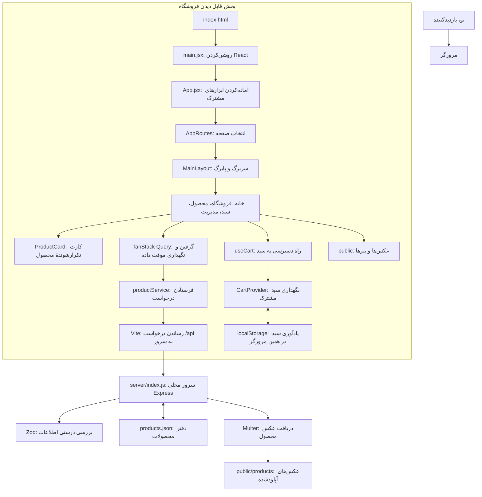
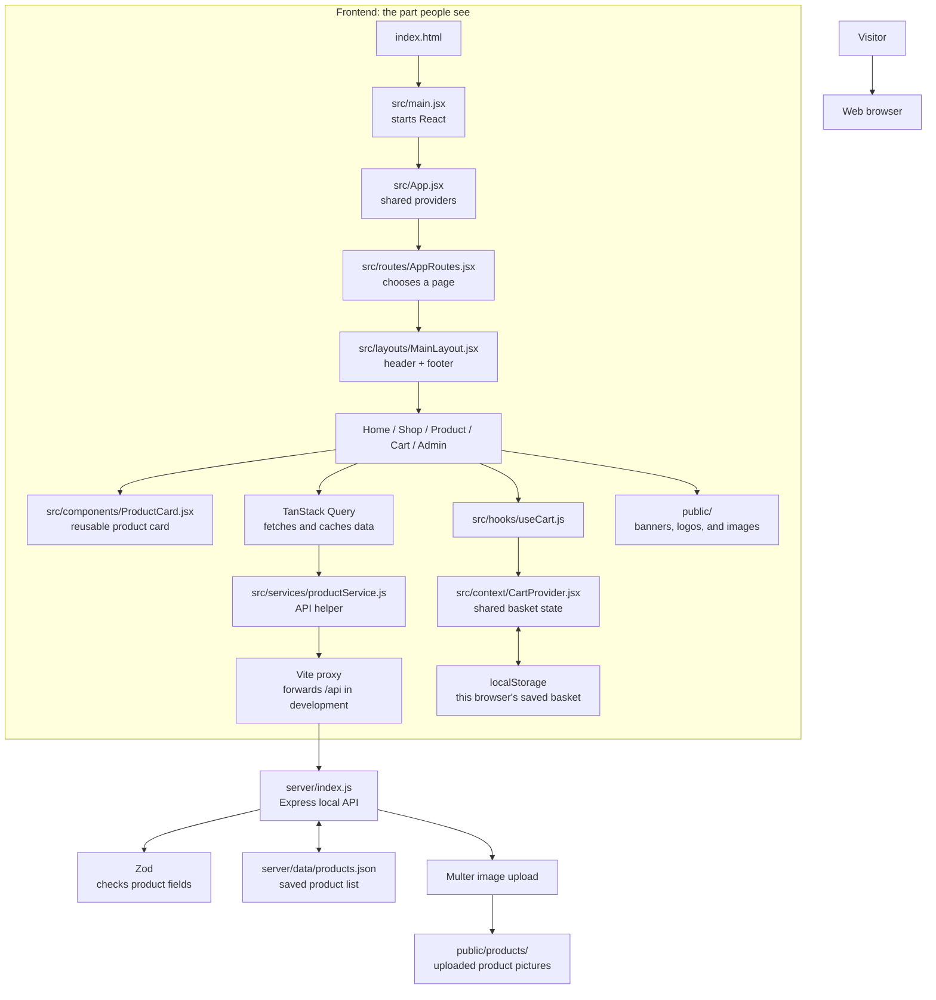

# Zihome Project Map

## نقشهٔ خیلی ساده به فارسی

این برنامه را مثل یک فروشگاه واقعی تصور کن: صفحه‌ها ویترین‌اند، سرور انباردار
است، فایل محصولات دفتر انبار است و سبد خرید داخل مرورگر خودت نگهداری می‌شود.

### قصهٔ رفت‌وآمد اطلاعات

- وقتی صفحهٔ خانه یا فروشگاه محصول می‌خواهد، از `productService` کمک می‌گیرد.
- درخواست از راه Vite به سرور محلی می‌رسد؛ سرور فهرست را از
  `server/data/products.json` می‌خواند و جواب را برمی‌گرداند.
- وقتی مدیر محصولی می‌سازد، عکس اول در `public/products/` ذخیره می‌شود؛ بعد
  آدرس عکس همراه بقیهٔ اطلاعات در دفتر `products.json` نوشته می‌شود.
- وقتی تو محصولی را به سبد اضافه می‌کنی، `CartProvider` آن را نگه می‌دارد و
  `localStorage` کمک می‌کند با تازه‌کردن صفحه سبد خالی نشود.

### هر چیز کجا می‌ماند؟

| چیز | جای نگهداری | مثلِ چه چیزی است؟ |
| --- | --- | --- |
| نام، قیمت و اطلاعات محصول | `server/data/products.json` | دفتر انباردار |
| عکس‌های محصول | `public/products/` | قفسهٔ عکس‌ها |
| سبد خرید | `localStorage` در مرورگر | سبدی که پیش خودت نگه می‌داری |

پس محصولات برای برنامه ذخیره می‌شوند، اما سبد خرید فعلاً فقط در مرورگر همین
دستگاه نگهداری می‌شود.

## حالا نقشه را قدم‌به‌قدم بخوانیم

### ۱. مرورگر از کجا شروع می‌کند؟

مرورگر اول فایل `index.html` را باز می‌کند. این فایل مثل ساختمان خالی فروشگاه
است: یک جای خالی به نام `root` دارد و می‌گوید فایل `src/main.jsx` را اجرا کن.
خود `index.html` محصولات یا صفحه‌های فروشگاه را نمی‌سازد.

### ۲. React چطور روشن می‌شود؟

`src/main.jsx` نقطهٔ شروع برنامه است. این فایل CSS اصلی را وارد می‌کند، جای
`root` را در صفحه پیدا می‌کند و برنامهٔ `App` را داخل آن نمایش می‌دهد. می‌توانی
آن را مثل روشن‌کردن چراغ‌های مغازه تصور کنی.

### ۳. `App.jsx` چه ابزارهایی را به همه می‌دهد؟

`src/App.jsx` چند ابزار عمومی را دور صفحه‌ها می‌گذارد:

- `QueryClientProvider` حافظهٔ موقت اطلاعاتی مثل فهرست محصولات را نگه می‌دارد.
  اگر صفحهٔ دیگری همان اطلاعات را بخواهد، React Query می‌تواند از حافظهٔ خودش
  استفاده کند. در تنظیم فعلی، داده تا پنج دقیقه تازه حساب می‌شود و نتیجهٔ بدون
  استفاده تا ده دقیقه در حافظه می‌ماند.
- `CartProvider` سبد خرید را بین صفحه‌ها مشترک می‌کند.
- `BrowserRouter` آدرس مرورگر را می‌خواند تا React بفهمد باید کدام صفحه را نشان
  بدهد.
- `AppRoutes` فهرست آدرس‌ها و صفحه‌های برنامه را می‌سازد.

این ابزارها دور همهٔ صفحه‌ها هستند تا هر صفحه لازم نباشد دوباره آن‌ها را بسازد.

### ۴. آدرس مرورگر چطور صفحه را انتخاب می‌کند؟

در `src/routes/AppRoutes.jsx` برای هر آدرس یک صفحه تعیین شده است:

| آدرس | صفحه‌ای که نمایش داده می‌شود |
| --- | --- |
| `/` | صفحهٔ خانه، یعنی `Home.jsx` |
| `/shop` | فروشگاه و فیلتر محصولات، یعنی `Shop.jsx` |
| `/products/:id` | جزئیات محصول مشخص، یعنی `ProductDetails.jsx` |
| `/cart` | سبد خرید، یعنی `Cart.jsx` |
| `/admin/products` | فهرست مدیریت محصولات |
| `/admin/products/new` | فرم افزودن محصول |
| `/admin/products/:id/edit` | فرم ویرایش محصولی با همان شناسه |
| هر آدرس ناشناخته | صفحهٔ `NotFound.jsx` |

`:` در `:id` یعنی آن قسمت از آدرس عوض می‌شود. مثلاً در
`/products/abc123` مقدار شناسه `abc123` است.

### ۵. چرا بیشتر صفحه‌ها سربرگ و پابرگ یکسان دارند؟

`src/layouts/MainLayout.jsx` قاب مشترک سایت را می‌سازد: نوار بالایی، جست‌وجو،
ناوبری، جای صفحه و پابرگ. بخش `<Outlet />` یک جای خالی مخصوص React Router است؛
صفحهٔ انتخاب‌شده در آن قرار می‌گیرد. به این ترتیب سربرگ و پابرگ لازم نیست در
تک‌تک صفحه‌ها دوباره نوشته شوند.

صفحهٔ ۴۰۴ بیرون از این قاب قرار دارد؛ چون آدرس ناشناخته، یکی از صفحه‌های عادی
فروشگاه نیست.

### ۶. هر صفحه چه کاری انجام می‌دهد؟

| فایل | کارش به زبان ساده |
| --- | --- |
| `src/pages/Home.jsx` | بنرها، دسته‌ها، محصولات ویژه و کارت‌های مجله را نشان می‌دهد. محصولاتش از API می‌آیند؛ محتوای کارت‌های مجله فعلاً ثابت است. |
| `src/pages/Shop.jsx` | محصولات را می‌گیرد و در مرورگر بر اساس نام، دسته و مرتب‌سازی فیلتر می‌کند. |
| `src/pages/ProductDetails.jsx` | با شناسهٔ داخل آدرس، یک محصول را می‌گیرد و امکان انتخاب تعداد و افزودن به سبد را می‌دهد. |
| `src/pages/Cart.jsx` | محتوای مشترک سبد را نشان می‌دهد، جمع قیمت را حساب می‌کند و تعداد را عوض می‌کند. |
| `src/pages/AdminProductList.jsx` | محصول‌های ذخیره‌شده را نشان می‌دهد و دکمه‌های ویرایش و حذف دارد. |
| `src/pages/AdminProducts.jsx` | یک فرم برای ساخت محصول جدید یا ویرایش محصول موجود دارد. |
| `src/pages/NotFound.jsx` | وقتی آدرسی با هیچ صفحه‌ای جور نیست، راه برگشت به خانه را نشان می‌دهد. |

خانه و صفحهٔ جزئیات سه وضعیت مهم را جدا می‌کنند: «در حال گرفتن اطلاعات»،
«گرفتن اطلاعات با خطا روبه‌رو شد» و «اطلاعات آماده است». این کار باعث می‌شود
صفحه هنگام انتظار خالی یا گیج‌کننده به نظر نرسد.

در صفحهٔ فروشگاه، جست‌وجو نام و توضیح محصول را بررسی می‌کند، دکمه‌های دسته
محصول‌های هم‌دسته را نشان می‌دهند و فهرست مرتب‌سازی بر اساس قیمت یا امتیاز
ترتیب را عوض می‌کند. این فیلترها فعلاً در مرورگر انجام می‌شوند.

در فرم مدیریت، وجود شناسه در آدرس یعنی «ویرایش»؛ نبودنش یعنی «محصول تازه».
برای ویرایش، فرم ابتدا همان محصول را از API می‌گیرد و فیلدهایش را پر می‌کند.
بعد از ذخیره یا حذف، صفحه به React Query می‌گوید فهرست‌های قبلی را تازه کند.

### ۷. کارت محصول چرا در چند جا استفاده می‌شود؟

`src/components/ProductCard.jsx` یک قطعهٔ قابل‌استفادهٔ دوباره است. خانه و
فروشگاه می‌توانند اطلاعات محصول را به آن بدهند؛ کارت خودش عکس، نام، امتیاز و
قیمت را نمایش می‌دهد. اگر ظاهر کارت عوض شود، با تغییر همین فایل می‌توانی آن را
در همهٔ جاهایی که استفاده شده به‌روز کنی.

### ۸. یک درخواست محصول از کجا رد می‌شود؟

وقتی خانه یا فروشگاه فهرست محصول می‌خواهد، این مسیر طی می‌شود:

1. صفحه با `useQuery` از TanStack Query درخواست می‌کند.
2. `queryFn` تابع `productService.getProducts()` را صدا می‌زند.
3. `productService` با Axios به `/api/products` درخواست می‌فرستد.
4. در زمان توسعه، `vite.config.js` درخواست `/api` را به پورت `3001` می‌فرستد.
5. `server/index.js` درخواست را می‌گیرد و محصولات را از JSON می‌خواند.
6. جواب از همان مسیر برمی‌گردد و React صفحه را با اطلاعات تازه نمایش می‌دهد.

Vite در این مسیر فقط پیک را به آدرس درست می‌رساند؛ خودش اطلاعات محصول را ذخیره
نمی‌کند.

### ۹. سرور و فایل محصولات چه کار می‌کنند؟

سرور در `server/index.js` با Express ساخته شده است. آن فایل مسیرهای API را
تعریف می‌کند و برای اطلاعات محصول از Zod کمک می‌گیرد. Zod بررسی می‌کند مثلاً
قیمت عدد مثبت، نام به‌اندازهٔ کافی بلند و موجودی عدد صحیحِ منفی‌نباشد.

فرم در مرورگر هم اطلاعات را بررسی می‌کند تا زودتر به کاربر پیام بدهد؛ بررسی
دوباره در سرور لازم است، چون سرور باید حتی به درخواست‌هایی که از فرم سایت
نیامده‌اند هم اعتماد نکند.

برای عکس، سرور فقط JPEG، PNG و WebP می‌پذیرد و اندازهٔ هر فایل حداکثر پنج
مگابایت است. فرم هم فیلدهایی مثل نام، دسته، قیمت، توضیح و موجودی را پیش از
فرستادن بررسی می‌کند.

قواعدی که Zod در سرور اعمال می‌کند را می‌توان این‌طور خواند:

- نام و دسته باید دست‌کم دو نویسه داشته باشند.
- قیمت باید عددی بزرگ‌تر از صفر باشد.
- عکس باید یک نشانی متنی داشته باشد.
- توضیح باید دست‌کم پنج نویسه داشته باشد.
- موجودی باید عدد صحیحِ صفر یا بیشتر باشد.
- `isFeatured` باید روشن یا خاموش باشد (`true` یا `false`).

اطلاعات در `server/data/products.json` نگهداری می‌شوند. این فایل یک آرایه از
محصول‌ها دارد؛ هر محصول شامل نام، دسته، قیمت، مسیر عکس، توضیح، موجودی و چند
فیلد دیگر است. شناسهٔ یکتا را سرور می‌سازد تا صفحه بتواند بعداً همان محصول را
پیدا کند.

### ۱۰. عکس معمولی و عکس آپلودی چه فرقی دارند؟

- عکس‌های طراحی مثل بنر و لوگو را خودمان در `public/` گذاشته‌ایم. صفحه با مسیری
  مثل `/mainbaner.png` آن‌ها را می‌خواند.
- عکس محصولی که از فرم مدیریت انتخاب می‌شود به `/api/uploads` فرستاده می‌شود.
  Multer فایل را در `public/products/` می‌نویسد و آدرس آن را به فرم برمی‌گرداند.
- فرم همان آدرس را در اطلاعات محصول می‌گذارد. بنابراین JSON خود عکس را نگه
  نمی‌دارد؛ فقط نشانی فایل عکس را نگه می‌دارد.

### ۱۱. درخواست‌های سرور چه معنی دارند؟

| درخواست | معنی ساده |
| --- | --- |
| `GET /api/products` | همهٔ محصولات را بخوان |
| `GET /api/products/:id` | محصولی را که این شناسه دارد بخوان |
| `POST /api/products` | یک محصول تازه بساز |
| `PATCH /api/products/:id` | اطلاعات محصولی را با این شناسه ویرایش کن |
| `DELETE /api/products/:id` | محصولی را با این شناسه حذف کن |
| `POST /api/uploads` | عکس انتخاب‌شده را آپلود کن و آدرسش را برگردان |

در حال حاضر دسته‌ها از مسیر جداگانه نمی‌آیند: `getCategories()` فهرست محصولات
را می‌گیرد و نام‌های دستهٔ تکراری را یکی می‌کند.

با اینکه نام روش ویرایش `PATCH` است، فرم فعلی همهٔ فیلدهای محصول را با هم
می‌فرستد؛ سرور هم همان مجموعهٔ کامل فیلدها را بررسی می‌کند.

### ۱۲. سبد خرید چطور با صفحه‌ها حرف می‌زند؟

`src/context/cartContext.js` جای ساخت Context است؛ Context مثل یک کانال مشترک
برای فرستادن مقدار سبد است. `src/context/CartProvider.jsx` مقدار واقعی سبد و
تابع‌های افزودن، حذف و تغییر تعداد را نگه می‌دارد. هر صفحه‌ای که `useCart()` را
صدا بزند می‌تواند به همان سبد دسترسی داشته باشد.

`localStorage` دفترچه‌ای کوچک در همان مرورگر است. با تازه‌شدن صفحه، Provider
دوباره اطلاعات دفترچه را می‌خواند. این سبد در کامپیوتر یا مرورگر دیگری خودبه‌خود
ظاهر نمی‌شود، چون هنوز روی سرور ذخیره نشده است.

چند قانون سبد هم در `CartProvider.jsx` نگه داشته شده است: محصول ناموجود اضافه
نمی‌شود؛ افزودن دوباره همان محصول، ردیف دومی نمی‌سازد؛ تعداد از موجودی بیشتر
نمی‌شود؛ و کم‌کردن تعداد تا صفر، آن ردیف را حذف می‌کند. صفحهٔ جزئیات هم اجازه
نمی‌دهد تعداد از یک کمتر یا از موجودی بیشتر شود.

### ۱۳. اصطلاح‌های نقشه

| واژه | معنی خیلی ساده |
| --- | --- |
| Frontend | بخشی که در مرورگر می‌بینی و با آن کار می‌کنی |
| Backend / Server | برنامه‌ای که درخواست‌ها را می‌گیرد و داده را می‌خواند یا می‌نویسد |
| API | درگاه و قانون گفت‌وگوی صفحه با سرور |
| Route | قانونی که می‌گوید هر آدرس کدام صفحه را نشان دهد |
| Component | تکه‌ای از صفحه که می‌توان آن را دوباره استفاده کرد |
| State | اطلاعاتی که ممکن است هنگام کار کاربر تغییر کند |
| Cache | یادداشت موقتی برای اینکه اطلاعات لازم بی‌دلیل دوباره گرفته نشود |
| `localStorage` | جای ذخیرهٔ کوچک داخل مرورگر همین دستگاه |

---

## مرور انگلیسیِ اختیاری

این بخش فقط برای آشنایی با واژه‌های انگلیسی فنی است؛ توضیح کامل فارسی بالاتر
قرار دارد.

### The whole project at a glance

## Imagine the store as a small shop

- **The frontend is the shop floor.** It shows the shelves, product cards, and
  buttons that a visitor can use.
- **A page is one room in the shop.** `Home`, `Shop`, `ProductDetails`, `Cart`,
  and the admin pages each have a different job.
- **`productService` is the messenger.** Pages ask it for products; it carries
  those requests to the local server.
- **The Express server is the stockroom clerk.** It reads or changes the saved
  product list and checks information before saving it.
- **`products.json` is the product notebook.** The local server saves product
  records there, so they remain after restarting the app.
- **The cart is a basket kept by the browser.** `CartProvider` shares it between
  pages, and `localStorage` remembers it after a refresh on this browser.
- **`public/` is the picture shelf.** Regular design images are served directly;
  uploaded product images are stored in `public/products/`.

## How the main journeys work

### A page reads products

1. `Home` or `Shop` asks TanStack Query for product data.
2. TanStack Query calls `productService` and keeps the result in a shared cache.
3. `productService` sends a request to `/api/products`.
4. During local development, Vite forwards `/api` to the Express server on port
   `3001`.
5. Express reads `server/data/products.json` and sends the products back.
6. The page displays the result with reusable `ProductCard` components.

### An admin adds a product

1. The admin form checks the fields in the browser.
2. The selected picture is uploaded to `/api/uploads` and saved in
   `public/products/`.
3. The server returns the picture's public path.
4. The form sends the product fields and that picture path to `/api/products`.
5. Express checks the fields again, creates an ID, and saves the product in
   `products.json`.
6. TanStack Query refreshes the product and category lists so the new product
   can appear on the pages.

### A visitor adds a product to the cart

1. The product page calls `useCart()` when the visitor presses the cart button.
2. `useCart()` reads the shared value managed by `CartProvider`.
3. `CartProvider` adds the product while respecting its available stock.
4. When the cart changes, the provider saves it in this browser's `localStorage`.
5. The header and cart page read the same shared basket.

## Two different kinds of saved data

| Information | Where it is saved | What remembers it |
| --- | --- | --- |
| Products and their details | `server/data/products.json` | The local Express server |
| Uploaded product pictures | `public/products/` | Files in the project |
| Cart items | Browser `localStorage` | The current browser on this computer |

That is why product data is shared by pages using the local API, while a cart is
currently saved separately in each browser.
